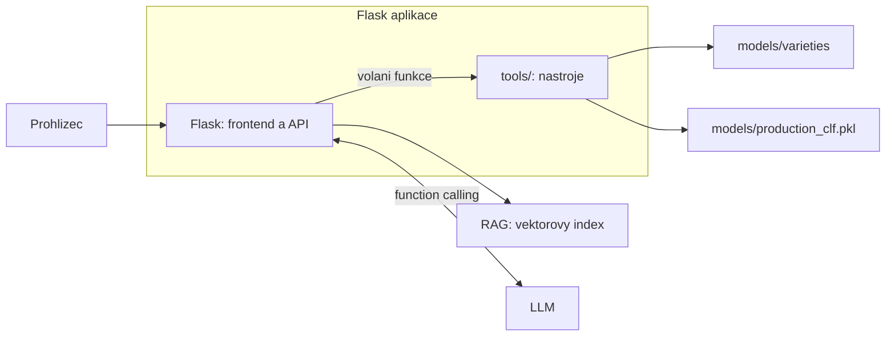

# ChillBot

AI chatbot o chilli paprickach s Flask frontendem a backendem a nastroji
(ML modely), ktere LLM vola pres function calling.

## Struktura

```text
web/            Flask aplikace a frontend
tools/          Nastroje pro LLM: klasifikace odrud a predikce produkce
data/
  training/     Trenovaci fotografie a anotace pro oba modely
  knowledge/    Dokumenty o chillipaprickach pro RAG
  vector_store/ Vektorovy index dokumentu
scripts/        Trenovani modelu a indexovani dokumentu
models/         Ulozene modely pro klasifikatory
tests/          Testy
pyproject.toml  Zavislosti a nastaveni Python projektu
Dockerfile      Image aplikace
compose.yaml    Spusteni kontejneru a pripojeni dat
.env.example    Vzor konfigurace bez tajnych hodnot
```

Nastroje `classify_plant_type` a `predict_production_rise` jsou obycejne
Python funkce v `tools/`. Jejich popisy pro LLM jsou v `tools/registry.py`.

## Architektura



Flask posle LLM seznam nastroju (`tools=`). Kdyz LLM pozada o volani
nastroje, Flask spusti prislusnou funkci lokalne, vysledek vrati LLM a to
pak odpovi uzivateli. LLM neni soucasti projektu; aplikace pouziva
OpenAI-kompatibilni endpoint.

## Rychle spusteni lokalne

Pouzij Python 3.11+ a spust prikazy z korene projektu:

```powershell
.\.venv\Scripts\Activate.ps1
if (!(Test-Path .env)) { Copy-Item .env.example .env }
python -m pip install -e .
```

Pri lokalnim spusteni se konfigurace nacita ze souboru `.env`.

Spust Flask:

```powershell
python -m web.app
```

Otevri `http://127.0.0.1:5000`. V aplikaci otevri **API settings** a
nastav API key pro OpenAI-kompatibilni endpoint.

## Docker Compose

Pokud mas pripraveny Docker Desktop, muzes konfiguraci overit a spustit:

```powershell
docker compose config --quiet
docker compose up --build
```

Aplikace bude dostupna na `http://127.0.0.1:5000`. Model
`models/production_clf.pkl` musi existovat a variety model se pri prvnim
pouziti stahne z Hugging Face.
Ukonceni:

```powershell
docker compose down
```
