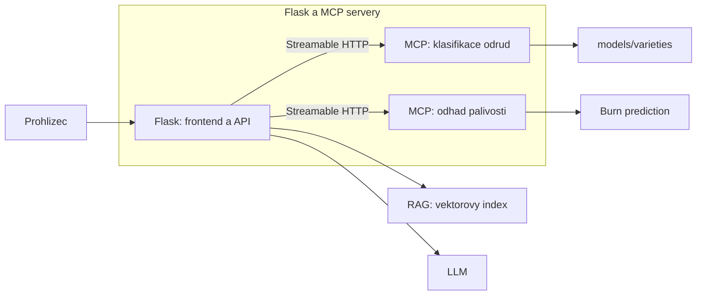

# ChillBot

AI chatbot o chilli paprickach s Flask frontendem a backendem a MCP
servery pro praci s chilli.

## Struktura

```text
web/            Flask aplikace, frontend a MCP klient
mcp_servers/    MCP servery: variety_classifier a will_it_burn
data/
  training/     Trenovaci fotografie a anotace pro oba modely
  knowledge/    Dokumenty o chillipaprickach pro RAG
  vector_store/ Vektorovy index dokumentu
scripts/        Trenovani modelu a indexovani dokumentu
models/         Ulozene modely: varieties/ a plant_health/
tests/          Testy
pyproject.toml  Zavislosti a nastaveni Python projektu
Dockerfile      Sdileny image pro vsechny tri kontejnery
compose.yaml    Spusteni kontejneru a pripojeni dat
.env.example    Vzor konfigurace bez tajnych hodnot
```

MCP servery poskytuji nastroje `classify_plant_type` a
`predict_burn_intensity`. Flask je zpristupni modelu jako nastroje a
zpracuje pripadne tool calls.

## Architektura



Flask komunikuje s MCP servery pres Streamable HTTP. LLM neni soucasti
projektu; aplikace pouziva OpenAI-kompatibilni endpoint.

## Rychle spusteni lokalne

Pouzij Python 3.11+ a spust prikazy z korene projektu:

```powershell
.\.venv\Scripts\Activate.ps1
python -m pip install -e .
```

Spust oba MCP servery v samostatnych terminalech:

```powershell
python mcp_servers\will_it_burn\server.py
```

```powershell
$env:MCP_HOST = "localhost"
$env:MCP_PORT = "5001"
python mcp_servers\variety_classifier\server.py
```

V dalsim terminalu spust Flask:

```powershell
python -m web.app
```

Otevri `http://127.0.0.1:5000`. V aplikaci otevri **API settings** a
nastav API key pro OpenAI-kompatibilni endpoint. MCP servery musi bezet
pred odeslanim prvni zpravy.

## Docker Compose

Pokud mas pripraveny Docker Desktop, muzes konfiguraci overit a spustit:

```powershell
docker compose config --quiet
docker compose up --build
```

Aplikace bude dostupna na `http://127.0.0.1:5000`. Ukonceni:

```powershell
docker compose down

```