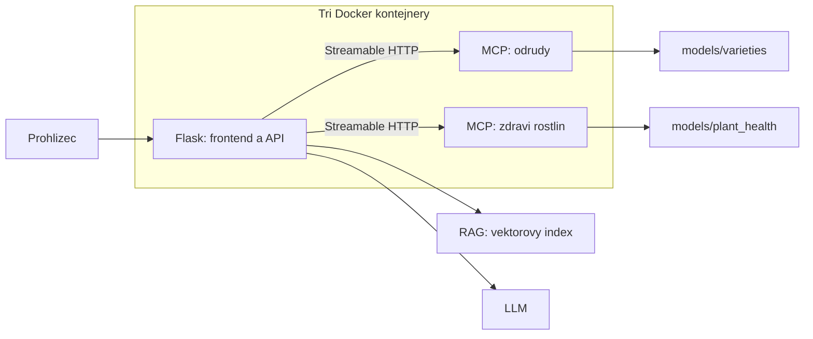

# ChillBot

AI chatbot o chillipaprickach s Flask frontendem a backendem, RAG
a dvema MCP servery pro rozpoznani odrud a zdravotniho stavu rostlin.

**Zatim jde jen o kostru projektu. Kod, zavislosti, data a modely chybi,
takze aplikaci ani Docker image zatim nelze spustit nebo sestavit.**

## Struktura

```text
flask/          Flask aplikace, frontend, RAG a MCP klient
mcp_servers/    Dva servery: variety_classifier a plant_health
data/
  training/     Trenovaci fotografie a anotace pro oba modely
  knowledge/    Dokumenty o chillipaprickach pro RAG
  vector_store/ Vektorovy index dokumentu
scripts/        Trenovani modelu a indexovani dokumentu
models/         Ulozene modely: varieties/ a plant_health/
tests/          Testy
pyproject.toml  Zavislosti a nastaveni Python projektu
Dockerfile      Sdileny image pro vsechny tri kontejnery
compose.yaml    Spusteni kontejneru a pripojeni dat
.env.example    Vzor konfigurace bez tajnych hodnot
```

Trenovaci skripty ukladaji modely do `models/`. MCP servery je pouze
nacitaji pro predikce. RAG vyhledava v dokumentech; netrenuje ML modely.
Data, vahy a tajne hodnoty se neverzuji ani nekopiruji do Docker image.

## Architektura



Pouze Flask je dostupny na hostiteli. MCP servery komunikuji v Docker siti
a maji sve modely pripojene jen pro cteni. LLM neni soucasti Compose.

## Priprava a spusteni

Potrebujes Docker Desktop s Linux containers a Docker Compose 2.24+.
Pred prvnim spustenim dopln kod, zavislosti do `pyproject.toml`, LLM
a embedding model, konfiguraci do `.env`, vahy ML modelu a RAG index.
Pro trenovani a indexovani mimo Docker pouzij Python 3.11 a skripty v `scripts/`.

Kontrola konfigurace funguje uz nyni:

```powershell
docker compose config --quiet
```

Po dokonceni implementace, z korene projektu:

```powershell
docker compose up --build -d
docker compose logs -f
docker compose down
```

Chat bude na `http://127.0.0.1:5000`.