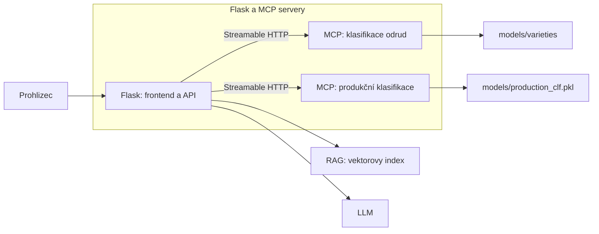

# ChillBot

AI chatbot o chilli paprickach s Flask frontendem a backendem a MCP
servery pro praci s chilli.

## Struktura

```text
web/            Flask aplikace, frontend a MCP klient
mcp_servers/    MCP servery: variety_classifier a production_classifier
data/
  training/     Trenovaci fotografie a anotace pro oba modely
  knowledge/    Dokumenty o chillipaprickach pro RAG
  vector_store/ Vektorovy index dokumentu
scripts/        Trenovani modelu a indexovani dokumentu
models/         Ulozene modely pro klasifikatory
tests/          Testy
pyproject.toml  Zavislosti a nastaveni Python projektu
Dockerfile      Sdileny image pro vsechny tri kontejnery
compose.yaml    Spusteni kontejneru a pripojeni dat
.env.example    Vzor konfigurace bez tajnych hodnot
```

MCP servery poskytují nástroje `classify_plant_type` a
`predict_production_rise`.

## Architektura



Flask komunikuje s MCP servery pres Streamable HTTP. LLM neni soucasti
projektu; aplikace pouziva OpenAI-kompatibilni endpoint.

## Rychle spusteni lokalne

Pouzij Python 3.11+ a spust prikazy z korene projektu:

```powershell
.\.venv\Scripts\Activate.ps1
if (!(Test-Path .env)) { Copy-Item .env.example .env }
python -m pip install -e .
```

Pri lokalnim spusteni se konfigurace nacita ze souboru `.env`.

Spust MCP servery v samostatnych terminalech:

```powershell
python -m mcp_servers.variety_classifier.server
```

```powershell
python -m mcp_servers.production_classifier.server
```

V dalsim terminalu spust Flask:

```powershell
python -m web.app
```

Otevri `http://127.0.0.1:5000`. V aplikaci otevri **API settings** a
nastav API key pro OpenAI-kompatibilni endpoint. MCP servery musi bezet
pred odeslanim prvni zpravy.

## Docker Compose

Pokud mas pripraveny Docker Desktop, muzes konfiguraci overit a spustit:

```powershell
docker compose config --quiet
docker compose up --build
```

Aplikace bude dostupna na `http://127.0.0.1:5000`. Compose spousti web,
klasifikator odrud a produkcni klasifikator. Model `models/production_clf.pkl`
musi existovat a variety model se pri prvnim pouziti stahne z Hugging Face.
Ukonceni:

```powershell
docker compose down

```